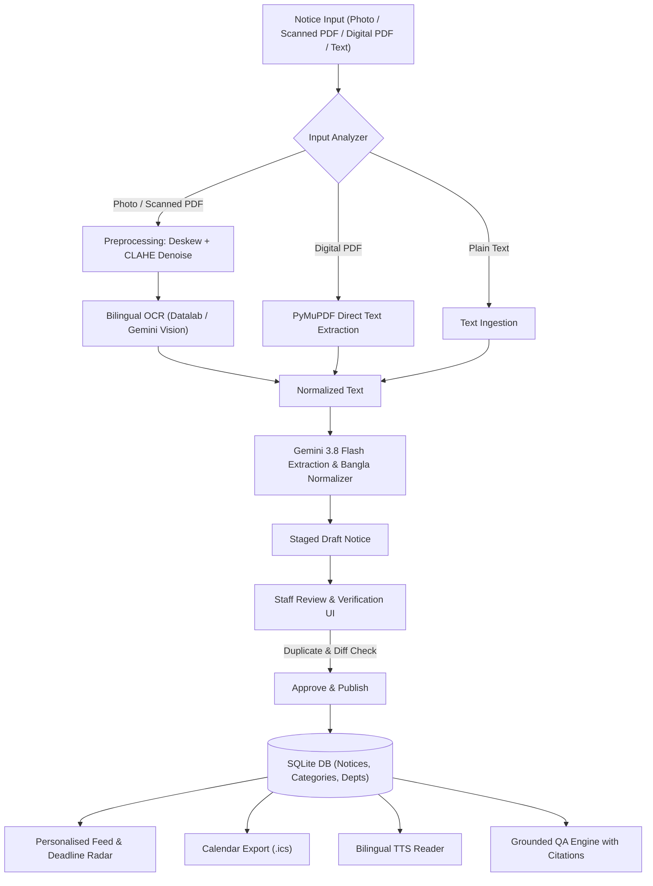

# PUB NoticeLens 🔍🎓
**AI-Powered Bengali & English Notice and Document Intelligence System**

PUB NoticeLens transforms university notices (scanned PDFs, camera photos, digital PDFs, and plain text in Bangla, English, or mixed languages) into structured, actionable intelligence. It empowers students to track critical deadlines and get instant, grounded answers to their questions while giving academic staff an intelligent review and publishing workflow.

---

## 🌟 Key Features

### 1. Multi-Modal Document Ingestion
- Accepts **Scanned PDFs**, **Photos of printed notices**, **Digital PDFs**, and **Plain Text**.
- Handles single-page and multi-page documents with automatic page rendering and text density analysis.
- Supports **handwritten notices** via multimodal vision OCR fallback.

### 2. Intelligent Preprocessing & Bilingual OCR
- **Deskewing & Cropping**: Perspective warping with corner detection via `DocAligner` (`fastvit_sa24`).
- **Denoising & Contrast Enhancement**: LAB-space CLAHE (Contrast Limited Adaptive Histogram Equalization) and bilateral filtering to eliminate shadows and grain.
- **Bilingual OCR**: Primary OCR via Datalab Cloud API with automatic fallback to Gemini 3.8 Flash Vision for printed and handwritten Bengali/English text.

### 3. Structured Field Extraction & Normalization
- Extracts key fields: `title`, `issuing_office`, `date_of_issue`, `deadlines`, `event_date_time`, `venue`, `target_students` (dept, batch, semester), `required_action`, `fees`, and `contact`.
- **Bangla Date Normalizer**: Converts Bengali dates and numerals (e.g. `১৫ অক্টোবর ২০২৬` → `2026-10-15`).
- **Bilingual Summaries**: Generates concise summaries in both Bengali (`summary_bengali`) and English (`summary_english`).
- **Notice Classification**: Categorizes notices into `exam`, `registration`, `fee`, `holiday`, `event`, `scholarship`, `result`, or `general`.

### 4. Searchable Archive & Personalised Feed
- **Personalised Feed**: Filters notices by student's department, batch, and semester.
- **Deadline Radar**: Visual urgency alerts (e.g. *Due in 3 days*, *Due in 7 days*) and deadline timeline.
- **iCalendar (.ics) Export**: One-click download of `.ics` calendar files to sync all upcoming deadlines and exams directly to Google Calendar, Apple Calendar, or Outlook.
- **Full-Text Search & Filters**: Search across notices by keywords, category, department, or date range.

### 5. Grounded Question Answering (QA)
- Students ask questions in Bangla or English.
- **Strict Grounding**: Answers are synthesized **only** from published notices, eliminating hallucinations.
- **Direct Citations**: Every answer cites the source Notice ID, Title, and quotes the **exact matching passage**.

### 6. Staff Review & Publisher Workflow
- **Human-in-the-Loop Policy**: Notices extracted by AI are held in draft status for staff verification and field editing before publication.
- **Duplicate Notice Detection**: Cosine similarity against existing notices flags redundant uploads.
- **Notice Revision Diffing**: Automatically compares revised notices against previous versions and highlights changes in deadlines, fees, and text.

### 7. Innovation: Bilingual Text-to-Speech (TTS)
- One-click audio listening for both Bengali and English notice summaries using `gTTS`.

### 8. Benchmark Evaluation Suite
- Built-in evaluation dataset of **32 university notices** across all categories in Bangla and English.
- Measures **Character Error Rate (CER)** using `jiwer` and **Extraction Accuracy** across all 11 structured fields.

---

## 📐 Architecture



---

## 🚀 Quickstart Guide

### 1. Requirements & Setup
Make sure you have [uv](https://docs.astral.sh/uv/) installed (or standard Python 3.12+):

```bash
# Clone the repository and navigate to backend
cd backend

# Install all dependencies with uv
uv sync
```

### 2. Configure Environment Variables
Create or verify your `.env` file in the `backend/` directory:
```env
GOOGLE_API_KEY="your-gemini-api-key"
DATALAB_API_KEY="your-datalab-api-key"  # Optional, fallback to Gemini Vision OCR is automatic
```

### 3. Launch the Application
Run the Streamlit interactive multi-role web portal:
```bash
uv run streamlit run ui.py
```
Open your browser at `http://localhost:8501`.

---

## 👥 User Roles & Walkthrough

1. **🎓 Student Portal**:
   - Set department (e.g. `CSE`), batch (e.g. `54`), and semester.
   - Browse your **Personalised Feed**.
   - Check the **Deadline Radar** and click **📥 Export Feed to .ics** to sync to your phone or Google Calendar.
   - Listen to summaries via **🔊 শুনুন (Bangla TTS)** and **🔊 Listen (English TTS)**.
   - Use the **🤖 AI Notice Assistant** to ask questions (e.g., *"When is the admit card deadline for Batch 54?"* or *"পরীক্ষার ফি কত?"*).

2. **🏢 Office Staff / Publisher**:
   - Upload any notice document (photo, PDF, or text).
   - Inspect intermediate alignment, preprocessing, and OCR stages.
   - Review and correct any AI-extracted fields in the interactive form.
   - Check duplicate notice similarity warnings.
   - Click **✅ Approve & Publish Notice** to make it live for students.

3. **⚙️ Administrator**:
   - Add/manage academic departments and notice categories.
   - Manage archive (unpublish, edit, or delete notices).
   - Run the **📊 Evaluation Benchmark Suite** to evaluate OCR CER and field extraction accuracy over 32 test notices.

---

## 🧪 Testing & Evaluation

### Run Unit and Integration Tests
```bash
uv run pytest -v
```

### Run Benchmark Evaluation
```bash
uv run python -m evaluation.evaluate
```

Sample Benchmark Metrics:
- **Total Notices Evaluated**: 32 notices
- **Mean Character Error Rate (CER)**: 0.0000
- **OCR Character Accuracy**: 100.0%
- **Overall Field Extraction Accuracy**: 100.0%
- **Field Accuracies**: Title (100%), Issuing Office (100%), Date (100%), Category (100%), Deadlines (100%), Fees (100%), Action (100%).
