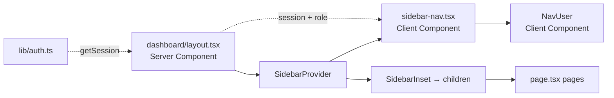

# Requirements

### Overview
Build a `/dashboard` page with a sidebar navigation and main content area. The sidebar includes navigation links (with role-based visibility), and a user account dropdown at the bottom. The main content area displays the current page title.

### Navigation Structure
- **Overview** — visible to all roles
- **Notices** — visible to all roles
- **Admin section** (visible to `staff` and `admin` only):
  - Upload Notice
  - Manage Notice
  - Manage Students
- **Manage Staffs** — visible to `admin` only
- **User account dropdown** (bottom of sidebar) — shows user info with options: Account, Notifications, Log out

### Key Decisions
- **Role-based navigation**: The sidebar will fetch the user's session/server role and conditionally render menu items. Server component fetches the session; the sidebar itself is a client component (required by shadcn's `SidebarProvider`), so role data is passed as a prop.
- **Icon library**: The user's `NavUser` code uses `lucide-react`, but the project uses `hugeicons`. All icons will be converted to hugeicons equivalents.
- **Auth integration**: Session data (`name`, `email`, `image`, `role`) is fetched server-side via `auth.api.getSession()` and passed to the client sidebar component.
- **Content area**: For now, each page just renders its title as a placeholder.

# Technical Design

### Current Implementation
- **Auth**: `lib/auth.ts` (server-side better-auth), `lib/auth-client.ts` (client), `lib/auth-guard.ts` (role checking with `requireRole()`). User has `name`, `email`, `image`, `role` fields.
- **Components**: shadcn base-maia style. Installed: button, card, field, input, label, select, separator, tabs.
- **Icons**: `hugeicons` — imported via `@hugeicons/react` + icon objects from `@hugeicons/core-free-icons` (see `app/login/page.tsx` pattern).
- **App structure**: Next.js App Router. `app/layout.tsx` wraps children in `ThemeProvider` + `Toaster`.

### Proposed Changes

**1. Install missing shadcn components**
Run `bunx --bun shadcn@latest add sidebar avatar dropdown-menu` which will also pull dependencies: `sheet`, `skeleton`, `tooltip`, `use-mobile` hook.

**2. Create `components/dashboard/nav-user.tsx`**
Adapt the user's provided `NavUser` component:
- Convert `lucide-react` icons → `hugeicons` equivalents
- Use `base` UI patterns (e.g. `render` instead of `asChild` where applicable)
- Remove unused menu items (Upgrade to Pro, Billing) — keep Account, Notifications, Log out
- Accept user data (`name`, `email`, `image`, `role`) as props

**3. Create `components/dashboard/sidebar-nav.tsx`**
Client component that renders the sidebar navigation:
- Uses `Sidebar`, `SidebarHeader`, `SidebarContent`, `SidebarGroup`, `SidebarMenu`, `SidebarMenuButton`, `SidebarFooter`
- Shows navigation items based on user's `role` prop
- Renders `NavUser` in the footer

**4. Create `app/dashboard/layout.tsx`**
Server component layout:
- Fetches session via `auth.api.getSession({ headers: await headers() })`
- Redirects to `/login` if no session
- Wraps children in `SidebarProvider` + `Sidebar` (with user/role props) + `SidebarInset` for content

**5. Create page routes**
- `app/dashboard/page.tsx` → Overview (default)
- `app/dashboard/notices/page.tsx` → Notices
- `app/dashboard/upload-notice/page.tsx` → Upload Notice
- `app/dashboard/manage-notice/page.tsx` → Manage Notice
- `app/dashboard/manage-students/page.tsx` → Manage Students
- `app/dashboard/manage-staffs/page.tsx` → Manage Staffs

Each page renders its title as a placeholder `h1`.

### File Structure
```
components/
  dashboard/
    nav-user.tsx        (new) — user dropdown in sidebar footer
    sidebar-nav.tsx     (new) — sidebar with nav items + NavUser
app/
  dashboard/
    layout.tsx          (new) — server layout, fetches session, wraps SidebarProvider
    page.tsx            (new) — Overview placeholder
    notices/
      page.tsx          (new) — Notices placeholder
    upload-notice/
      page.tsx          (new) — Upload Notice placeholder
    manage-notice/
      page.tsx          (new) — Manage Notice placeholder
    manage-students/
      page.tsx          (new) — Manage Students placeholder
    manage-staffs/
      page.tsx          (new) — Manage Staffs placeholder
components/ui/           (new files added by shadcn CLI)
  sidebar.tsx
  avatar.tsx
  dropdown-menu.tsx
  sheet.tsx
  skeleton.tsx
  tooltip.tsx
hooks/                   (new file added by shadcn CLI)
  use-mobile.ts
```

### Architecture Diagram


# Delivery Steps

### ✓ Step 1: Install shadcn sidebar, avatar, and dropdown-menu components
Add the missing UI components and their dependencies via the shadcn CLI using bun.
- Run `bunx --bun shadcn@latest add sidebar avatar dropdown-menu`
- This installs: sidebar, avatar, dropdown-menu, plus dependencies (sheet, skeleton, tooltip, use-mobile hook)
- Verify the installed files in `components/ui/` and `hooks/` are correct

### ✓ Step 2: Create NavUser and SidebarNav components
Build the two client components that form the sidebar UI.
- Create `components/dashboard/nav-user.tsx` — adapts the user's provided code, converts lucide icons to hugeicons, keeps Account/Notifications/Log out menu items, accepts user props (name, email, image, role)
- Create `components/dashboard/sidebar-nav.tsx` — renders SidebarHeader with app branding, SidebarContent with navigation groups (Overview, Notices, admin-only items, admin-only Manage Staffs), and SidebarFooter with NavUser. Role-based visibility controlled via a `role` prop.

### ✓ Step 3: Create dashboard layout and page routes
Build the server-side layout and placeholder pages.
- Create `app/dashboard/layout.tsx` — server component that fetches the session via `auth.api.getSession`, redirects to `/login` if unauthenticated, wraps content in `SidebarProvider` + `SidebarNav` (passing user data) + `SidebarInset` for children
- Create `app/dashboard/page.tsx` — Overview placeholder with title
- Create `app/dashboard/notices/page.tsx` — Notices placeholder
- Create `app/dashboard/upload-notice/page.tsx` — Upload Notice placeholder
- Create `app/dashboard/manage-notice/page.tsx` — Manage Notice placeholder
- Create `app/dashboard/manage-students/page.tsx` — Manage Students placeholder
- Create `app/dashboard/manage-staffs/page.tsx` — Manage Staffs placeholder

### ✓ Step 4: Fix DropdownMenu context error in NavUser
Wrap `DropdownMenuLabel` and standalone `DropdownMenuItem` elements in `DropdownMenuGroup` to satisfy `@base-ui/react` context requirements.
- In `components/dashboard/nav-user.tsx`, wrap the `DropdownMenuLabel` (line 77) in a `DropdownMenuGroup`
- Wrap the standalone "Log out" `DropdownMenuItem` (line 101) in a `DropdownMenuGroup`
- Verify the dropdown opens without the "MenuGroupContext is missing" error

### ✓ Step 5: Implement logout functionality and auth redirects
Make the logout button actually sign out the user, and redirect authenticated users away from login/signup pages.
- In `components/dashboard/nav-user.tsx`, add `onClick` handler to the "Log out" `DropdownMenuItem` that calls `authClient.signOut()` and redirects to `/`
- In `app/login/page.tsx`, add server-side session check that redirects to `/dashboard` if authenticated
- In `app/signup/page.tsx`, add server-side session check that redirects to `/dashboard` if authenticated

### ✓ Step 6: Build a beautiful landing page
Replace the placeholder `app/page.tsx` with a polished landing page for PundraNoticeLens.
- Install `badge` shadcn component for feature badges
- Create a hero section with app name, tagline, and Login/Sign up buttons
- Add a features section highlighting key capabilities (view notices, manage notices, student portal)
- Use `Card` components for feature cards with hugeicons
- Add a footer section
- Ensure the page looks great in both light and dark modes using semantic colors

### ✓ Step 7: Add better-auth admin plugin and install table component
Enable the admin plugin for `listUsers` and `revokeUserSessions` APIs, and install the shadcn Table component.
- In `lib/auth.ts`, add `admin()` from `better-auth/plugins` to the plugins array
- In `lib/auth-client.ts`, add `adminClient()` from `better-auth/react/plugins` to the plugins array
- Run `bunx --bun shadcn@latest add table` to install the Table component

### ✓ Step 8: Build Staff Management Table
Replace the placeholder `/dashboard/manage-staffs` page with a staff management table.
- **`app/dashboard/manage-staffs/page.tsx`**: Server component that:
  - Fetches the session to verify the current user is an admin (redirect if not)
  - Calls `auth.api.listUsers()` to get all users, filters to `role === "staff"`
  - Renders a `Card` wrapping a `Table` with columns: Name, Email, Actions
  - "Revoke Access" button uses a server action (`revokeStaffAccess`) that calls `auth.api.revokeUserSessions()` to revoke all sessions for that staff user
  - Shows an empty state ("No staff members found") when there are no staff users
  - Uses hugeicons for the revoke button icon (e.g., `BanIcon` or `Block01Icon`)
  - After revoking, revalidates the page to refresh the list

### ✓ Step 9: Fix signup error — add missing admin plugin fields to Drizzle schema
The `admin` plugin requires `banned`, `banReason`, and `banExpires` fields on the `user` table, and `impersonatedBy` on the `session` table. These are missing from the Drizzle schema, causing signup to fail with a 422 error.
- **`auth-schema.ts`**: Add `banned` (boolean, default false), `banReason` (text), and `banExpires` (integer timestamp) fields to the `user` table. Add `impersonatedBy` (text) to the `session` table.
- Run `bunx drizzle-kit push` (or equivalent) to apply the schema changes to the SQLite database so the new columns exist.

### ✓ Step 10: Fix next-themes script tag error — migrate to @teispace/next-themes
`next-themes` v0.4.x is unmaintained and injects a `<script>` tag inside a React component, which React 19 (Next.js 16) no longer allows. `@teispace/next-themes` is a maintained, API-compatible fork that resolves this.
- In `package.json`, replace `"next-themes": "^0.4.6"` with `"@teispace/next-themes": "^2.0.4"`
- Run `bun install` to update dependencies
- In `components/theme-provider.tsx`, change `import { ThemeProvider as NextThemesProvider, useTheme } from "next-themes"` to `import { ThemeProvider as NextThemesProvider, useTheme } from "@teispace/next-themes"`
- Verify the console error is gone and theme switching still works

### ✓ Step 11: Fix form action error in manage-staffs page
Next.js 16 doesn't allow passing an async wrapper function as a form action to client components. The server action must accept `FormData` directly.
- In `app/dashboard/manage-staffs/page.tsx`, change `revokeStaffAccess(userId: string)` to `revokeStaffAccess(formData: FormData)` and extract `userId` via `formData.get("userId")`
- Add a hidden `<input type="hidden" name="userId" value={user.id}>` to the form
- Pass `revokeStaffAccess` directly as the form action instead of wrapping it in an async function