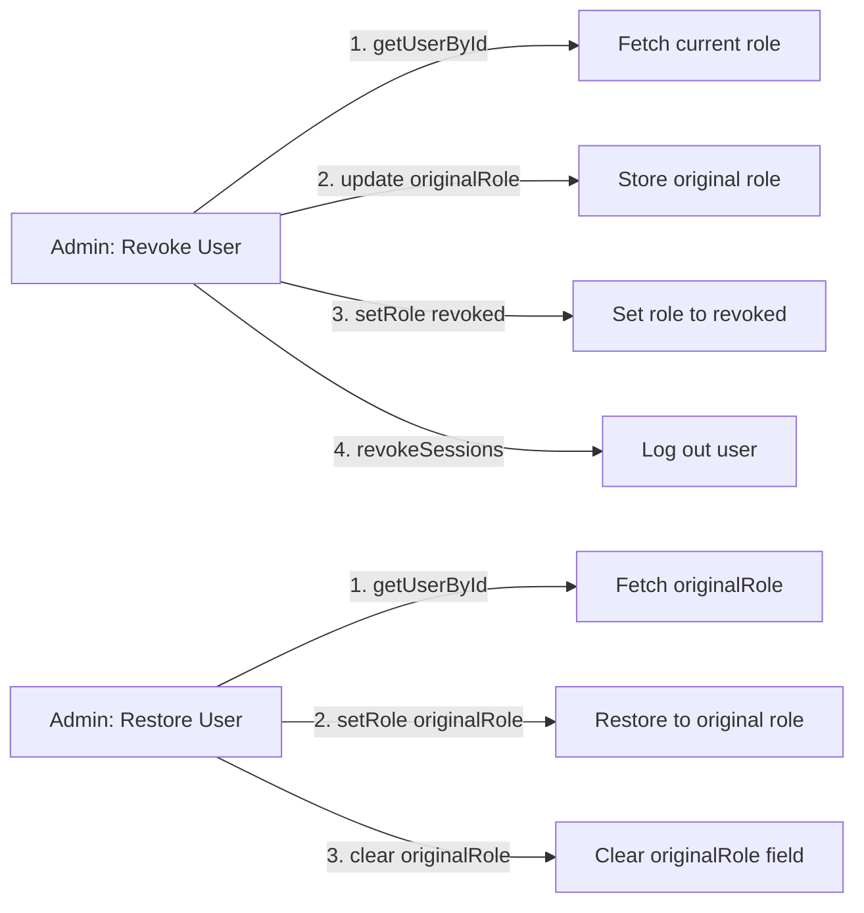

# Technical Design

### Current Implementation
- `lib/user-actions.ts`: `revokeUser` sets role to "revoked" and revokes sessions. `restoreUser` hardcodes role back to "student".
- `auth-schema.ts`: The `user` table has a `role` field (text, default "student") but no field to store the original role before revocation.
- `lib/auth.ts`: Better Auth is configured with `additionalFields` including `role`. The admin plugin accepts any string role via `setRole`.

### Key Decisions
- **Store original role in the `user` table**: Add a new `originalRole` column to the `user` table to track the role before revocation. This is the simplest and most reliable approach — no JSON parsing, no external storage.
- **Set `originalRole` before revoking**: In the `revokeUser` action, first fetch the user's current role, then update `originalRole` to that value, then set role to "revoked".
- **Restore from `originalRole`**: In the `restoreUser` action, read the `originalRole` field and set the role back to that value. Default to "student" if `originalRole` is null.

### Proposed Changes

#### 1. Add `originalRole` column to the `user` table
- Add `originalRole: text("original_role")` to `auth-schema.ts`.
- Run Drizzle migration to add the column to the SQLite database.

#### 2. Update `revokeUser` action in `lib/user-actions.ts`
- Before setting role to "revoked", fetch the user's current role via `auth.api.getUserById()`.
- Update the `originalRole` field to store the current role using a direct database update (via Drizzle) or `auth.api.updateUser()` if available.
- Then proceed with setting role to "revoked" and revoking sessions.

#### 3. Update `restoreUser` action in `lib/user-actions.ts`
- Fetch the user's `originalRole` field.
- Set the role back to `originalRole` (default to "student" if null).
- Clear the `originalRole` field after restoration.

### File Structure
```
auth-schema.ts                # MODIFIED - add originalRole column
lib/user-actions.ts           # MODIFIED - store original role on revoke, restore from it
```

### Architecture Diagram


### Risks
- **Better Auth `updateUser` API**: The admin plugin may not expose a general `updateUser` endpoint for arbitrary fields. If not available, we'll need to use Drizzle directly to update the `originalRole` column.
- **Existing revoked users**: Users already revoked before this change won't have an `originalRole`. They'll default to "student" on restore.

# Testing

### Validation Approach
Manually verify each flow by testing the server actions and page rendering.

### Key Scenarios
1. **Revoke staff**: Admin navigates to manage-staffs, clicks Revoke Access on a staff user. The staff user's role is set to "revoked", `originalRole` is set to "staff", and sessions are revoked.
2. **Restore staff**: Admin navigates to manage-revoked, clicks Restore. The user's role is set back to "staff" (from `originalRole`), and `originalRole` is cleared.
3. **Revoke student**: Admin revokes a student. `originalRole` is set to "student". Restore brings them back to "student".
4. **Revoked user experience**: A revoked user tries to access `/dashboard` and is redirected to `/revoked`.
5. **Empty states**: Each listing page shows the Empty component when no users match the filter.

### Edge Cases
- Admin tries to revoke themselves (should be prevented or handled gracefully).
- Restoring a user who was revoked before this change (no `originalRole`, defaults to "student").
- Concurrent revoke/restore actions on the same user.

# Delivery Steps

### ✓ Step 1: Add shadcn components and configure revoked role
Add the missing shadcn components (alert, alert-dialog, empty) and register "revoked" as a valid role in the admin plugin config.
- Run `npx shadcn@latest add alert alert-dialog empty` to install components.
- Fix any import path issues in added components per project alias.
- Update `lib/auth.ts` admin plugin config to include "revoked" in the valid roles list.

### ✓ Step 2: Create UserDataTable reusable component
Build a shared user listing table component used by manage-staffs, manage-students, and manage-revoked pages.
- Create `components/dashboard/user-data-table.tsx`.
- Accept props: users array, title, description, action type (revoke/restore), empty state config.
- Render Card with Table, Badge for role display, action buttons, and Empty state.
- Follow shadcn rules: gap spacing, Badge variants, data-icon on icons.

### ✓ Step 3: Fix revoke action and create revoked page
Implement the actual revoke logic and the revoked user landing page.
- Create a shared server action `revokeUser` that calls `auth.api.setRole({ role: "revoked" })` and `auth.api.revokeUserSessions()`.
- Create `app/revoked/page.tsx` with Alert + Card showing "Your account got revoked. Please contact the administration for more information." and a Sign Out button.
- Update `app/dashboard/layout.tsx` to redirect users with role "revoked" to `/revoked`.

### ✓ Step 4: Refactor manage-staffs, implement manage-students, add manage-revoked
Update all three user management pages to use the shared UserDataTable component.
- Refactor `app/dashboard/manage-staffs/page.tsx` to use UserDataTable with revoke action.
- Implement `app/dashboard/manage-students/page.tsx` with UserDataTable, listing students filtered by role="student", with revoke action.
- Create `app/dashboard/manage-revoked/page.tsx` with UserDataTable, listing revoked users, with restore action (sets role back to "student").
- Add "Manage Revoked" link to sidebar nav in `components/dashboard/sidebar-nav.tsx` under the admin group.

### ✓ Step 5: Track and restore original user role
Store the user's original role before revoking so restore brings them back to their correct role.
- Add `originalRole` text column to the `user` table in `auth-schema.ts`.
- Run Drizzle migration to add the column to the SQLite database.
- Update `revokeUser` in `lib/user-actions.ts` to fetch the user's current role, store it in `originalRole`, then set role to "revoked".
- Update `restoreUser` in `lib/user-actions.ts` to read `originalRole`, set the role back to that value (default "student" if null), and clear `originalRole`.